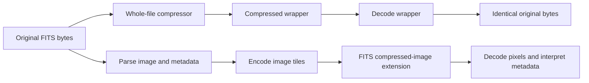

# FITS compression research

Research date: October 15, 2026. Scope: astronomical image storage, scientific
fidelity, and implications for NightSeam Catalog. This is research and a proposed
direction, not an implemented compression feature. That initial study used
synthetic images; it did not read or convert user exposures or configured archives.

Implementation follow-up: compressed metadata reading was subsequently added in
app/fits_metadata.py for gzip wrappers and tiled FITS, preserving uploaded bytes.
The implementation-state discussion below describes the researched d941c9f
baseline; DEVELOPMENT.md and CATALOG_IMPORT_GUIDE.md describe current behavior.
Implementation follow-up: manual session Rice compression/restoration and
opt-in Rice compression during ingest were subsequently implemented. They use
native fpack/funpack and require exact full-file SHA-256 restoration; floating
point images are never automatically Rice-quantized. DEVELOPMENT.md and
CATALOG_IMPORT_GUIDE.md describe the current behavior. Recommendations below
retain the original research scope.

Real-data follow-up: the later [example-data benchmark](<example-data-compression-benchmark-20261015.md>)
tests the user-supplied Seestar S30 light frames. Its measured session-archive
recommendation is ZIP/Bzip2 for space savings, with Zstd6 as the fast alternative.
The original synthetic measurements and general FITS discussion below retain
their original scope; they do not establish the best codec for those real frames.

Exact-restoration follow-up: the [native fpack/funpack experiment](<fpack-funpack-roundtrip-20261015.md>)
restored all 2,057 supplied integer FITS files with their original complete-file
SHA-256 using `fpack -r` followed by `funpack -C`. No external header sidecar or
output repair was used. The initial pixel tests below did not establish that
property; they also do not imply that tiled Rice necessarily prevents exact
original-file restoration. Encoding implementation and checksum options matter.

## Findings and recommended direction

For an interoperable compressed image, Rice is a strong first candidate for
ordinary 16-bit integer exposures. For exact floating-point pixels, start with
GZIP_2 and explicitly disable quantization. For recovering the exact original
FITS file, a lossless whole-file wrapper is the clearer contract. These are
different preservation goals and should be separate product choices.

NightSeam should first learn to read metadata from existing compressed FITS while
preserving uploaded bytes. Automatic recompression would require a separate
storage design because present deduplication and integrity checks hash the actual
original file bytes. My recommendation is to retain lossless originals as the
default and reserve quantized products for an explicitly selected derivative
workflow with a documented error budget.

The strongest local finding is a silent conversion trap in the installed Astropy
7.2.2: RICE_1 with floating-point input and quantize_level=0 truncates fractional
pixels. GZIP_2 with quantize_level=0 preserved all tested floating-point bits.
The reproduction and limitations are described below.

## What exactly is preserved?

| Preservation contract | What must match after restoration | Suitable approach |
| --- | --- | --- |
| Original file | Every original byte, including all HDUs, cards, ordering and padding | Lossless wrapper over the unchanged byte stream, followed by SHA-256 verification |
| Image data | Pixel values and required interpretation metadata | Validated lossless tiled image compression, with a separate metadata contract |
| Scientific measurements | Agreed tolerances on relevant measurements | Quantization evaluated against the actual processing workflow |

Equal pixels do not establish equal FITS files. A converter can change HDU
structure, header formatting, checksums or padding. Conversely, matching decoded
numeric values does not prove preservation of NaN payloads, signed zeros, integer
widths, or scaling semantics. Choose the comparison that matches the promise.

For byte-preserving wrappers, hash the restored byte stream directly; do not
decode and reserialize through a FITS writer before comparing it. Reproducible
compressed bytes are another issue: gzip embeds metadata, so pinning mtime and
codec settings is useful but does not establish identical output across every
codec version. [Python gzip documentation](https://docs.python.org/3/library/gzip.html)

## Two compression layers

Whole-file compression, such as .fits.gz, wraps the complete FITS byte stream.
The outer stream must be decoded to interpret FITS headers. Astropy supports
several external compression formats, with format-specific restrictions; that
capability does not mean NightSeam currently accepts them.
[Astropy FITS file handling](https://docs.astropy.org/en/stable/io/fits/)

Tiled compression stores compressed image tiles in a FITS binary-table extension.
Headers remain readable and individual tiles or HDUs can be decoded separately.
ZIMAGE, ZCMPTYPE, ZBITPIX, ZNAXISn and ZTILEn describe the representation. The .fz
suffix is conventional; the contents determine the format. Compression is covered
by the FITS standard, not a proprietary substitute for FITS.
[FITS standard overview](https://fits.gsfc.nasa.gov/fits_standard.html),
[tiled-image convention](https://fits.gsfc.nasa.gov/registry/tilecompression/tilecompression2.3.pdf)



The diagram describes contracts to verify, not a claim that any arbitrary
implementation automatically satisfies them.

## Codec selection

| Method | Useful starting point | Preservation conditions and tradeoffs |
| --- | --- | --- |
| RICE_1 | Integer sensor exposures | Efficient prediction of neighboring pixel differences; use supported integer types without lossy preprocessing |
| GZIP_1 | General tiled image compression | Ordinary per-tile gzip; floating-point quantization must be explicitly controlled |
| GZIP_2 | Exact floating-point image pixels | Shuffles pixel bytes before gzip; use quantize_level=0 for the tested Astropy path |
| HCOMPRESS_1 | Alternative for integer images | Reversible mode uses scale=0; nonzero scale introduces loss; compare size and read cost |
| PLIO_1 | Suitable integer masks | Specialized codec with restricted values/types; not a general exposure default |
| Whole-file gzip | Exact original-file restoration | Straightforward byte-stream contract; different access properties from tiled FITS |

These are the established CFITSIO families; GZIP_2 improves grouping of similar
significance bytes before compression. Avoid choosing solely by the codec name:
preprocessing settings determine whether floating-point values survive exactly.
[CFITSIO image compression](https://heasarc.gsfc.nasa.gov/docs/software/fitsio/c/c_user/node41.html)

Current Astropy documentation also warns about 64-bit integer compatibility:
some GZIP outputs readable by Astropy are not readable by CFITSIO-based tools,
and Rice/Hcompress have integer range restrictions. Those combinations were not
validated in this research. A successful Astropy self-roundtrip is insufficient
evidence of broad interoperability.
[Astropy supported integer compression types](https://docs.astropy.org/en/stable/io/fits/usage/unfamiliar.html#supported-integer-data-types)

Zstandard, xz and other whole-file compressors are additional candidates when a
wrapper format is acceptable. They should be evaluated as separate storage
encodings; the tiled codecs listed above do not imply built-in FITS support for
them. No Zstandard or xz benchmark was performed here. Python's standard-library
Zstandard interface was added in 3.14, so NightSeam's Python 3.12 build would need
an additional integration or dependency.
[Python Zstandard documentation](https://docs.python.org/3/library/compression.zstd.html)

## Why noise controls the savings

Noise carries entropy that lossless compression cannot discard. A useful model
for Gaussian background noise in integer samples is:

    noise_bits = log2(sigma * sqrt(12))
    compression_ratio ~= BITPIX / (noise_bits + codec_overhead_bits)

Sigma is measured in stored pixel units; this is an approximate model, not a
universal predictor. It explains why low-noise bias frames can compress much more
than bright flats or noisy long exposures. Nominal ADC depth alone does not
determine compressibility. Correlation, scaling and the actual sample distribution
also matter. Historical Rice advantages reported in the literature describe
particular datasets and implementations, rather than guaranteed present-day
throughput. [Pence, Seaman and White, 2009](https://arxiv.org/abs/0903.2140)

A ratio of 2 means half the original storage, not a 200% reduction. In general,
savings = 1 - 1/ratio. The synthetic 1.68 ratio below represents about 40.5% saved;
3.08 represents about 67.5%. Apply measured ratios to each frame class rather
than predicting the whole archive from a single favorable image.

## Floating-point quantization

With positive q, the usual quantization spacing is approximately delta=sigma/q.
Under the paper's quantization-noise model:

    output_noise / input_noise = sqrt(1 + 1/(12*q*q))

| q | Modeled increase in total RMS noise |
| --- | ---: |
| 1 | 4.0833% |
| 2 | 1.0363% |
| 4 | 0.2601% |
| 8 | 0.0651% |
| 16 | 0.0163% |

These percentages describe total RMS noise, not maximum pixel error or a
universal photometry guarantee. Subtractive dithering reduces quantization bias;
it does not recover discarded values. The published experiments support useful
scientific precision under their tested conditions. They do not validate every
calibration, faint-signal, stacking or nonlinear analysis workflow.
[Pence, White and Seaman, 2010](https://arxiv.org/abs/1007.1179)

For NightSeam, my proposed default is exact preservation for raw lights, darks,
biases, flats and master calibration products. If lossy derivatives are offered,
validate fluxes, centroids, background estimates and the final stacked output on
representative data. Record q, dithering method, seed, codec and software version.
Repeated quantization of already quantized products deserves separate testing.

Do not transfer defaults between tools. The inspected Astropy 7.2.2 signature
uses q=16 and NO_DITHER (-1). Its installed prose contains a contradictory claim
about the dithering default; the source constants and constructor establish the
actual behavior. Specify the method explicitly when it matters.

## Synthetic measurements in this workspace

Environment: Windows, Python 3.12, Astropy 7.2.2, NumPy 2.5.4. Four 1024x1024
synthetic images, random seed 20261015, three timed repetitions per method.
The probe used only in-memory FITS containers and wrote its script/results under
ignored logs/fits-compression-research-20261015/. No actual exposures were opened.

The integer inputs were low-noise uint16 samples (sigma=5), a gradient/star field
with uint16 noise (sigma=100), and uniform-random uint16 samples. The float32
input used the same kind of gradient/star field with sigma=100 noise. The probes
exercise algorithm behavior; they are not a representative camera survey.

Ratios below include FITS headers/table overhead. Larger is better; below 1 means
the result grew. Whole-file gzip used level 6. Tiled codecs used their own defaults
and default tile shapes; compression levels and tile shapes were not normalized.

| Synthetic uint16 image | Whole gzip | Tiled Rice | Tiled GZIP_2 | Hcompress, scale=0 |
| --- | ---: | ---: | ---: | ---: |
| Low noise | 2.74x | 3.08x | 3.11x | 3.24x |
| Noisier light field | 1.42x | 1.68x | 1.46x | 1.74x |
| Uniform random | ~1.00x | 0.99x | 0.98x | 0.96x |

All tested integer methods preserved pixel bits. Whole gzip restored the complete
original FITS byte stream exactly. Tiled tests verified decoded pixel bits; they
did not establish reconstruction of the original FITS file bytes.

| Synthetic float32 method | Ratio | Exact pixel bits | Pixel-error RMS |
| --- | ---: | --- | ---: |
| Whole gzip, level 6 | 1.20x | Yes | 0 |
| GZIP_1, q=0 | 1.17x | Yes | 0 |
| GZIP_2, q=0 | 1.32x | Yes | 0 |
| Rice, q=0 diagnostic | 3.34x | **No** | 0.5772 |
| Rice, default q=16/no dither | 4.46x | No | 1.7717 |
| Rice, q=4/subtractive dither 1 | 6.15x | No | 7.0826 |
| Rice, q=16/subtractive dither 1 | 4.46x | No | 1.7706 |

For the noisy uint16 field, median encode/decode times were 173.2/13.9 ms for
whole gzip, 39.0/24.6 ms for Rice, 206.9/49.7 ms for GZIP_2, and 37.9/43.5 ms for
Hcompress. These measure Python/Astropy construction, in-memory serialization,
decoding and copying. They exclude disk throughput, archive locking, antivirus,
UI responsiveness and independent fpack execution. They do not support a claim
that one decoder is universally faster. No peak-memory or sustained-import
benchmark was performed.

An additional GZIP_2/q=0 probe preserved the tested float32 and float64 bit
patterns for positive/negative zero, positive/negative infinity and a quiet NaN
with a payload. This is evidence for those patterns in this version, not an
exhaustive proof over all floating-point representations.

### The Rice/q=0 trap

The installed source skips quantization when q=0, then the Rice encoder casts
float samples to int32. A separate synthetic check decoded
100.125, 100.5, 101.875, 102.999 as 100, 100, 101, 102, with no warning.
Thus disabling the quantizer is not equivalent to choosing a codec that preserves
floating-point bytes.

Source evidence in the installed Astropy compressed module directory:

- `astropy/io/fits/hdu/compressed/header.py:341` omits ZSCALE/ZZERO at q=0.
- `astropy/io/fits/hdu/compressed/_tiled_compression.py:631` checks for ZSCALE; line 697 dispatches the requested codec.
- `astropy/io/fits/hdu/compressed/_codecs.py:299` converts Rice input to integers.
- `astropy/io/fits/hdu/compressed/settings.py:27` establishes NO_DITHER as the actual default.

The fpack guide explicitly requires GZIP when q=0 for exact floating-point
compression. Use GZIP_2/q=0 as a candidate, then independently verify the result.
This research establishes the trap in installed Astropy 7.2.2; newer releases
were not installed or tested.
[fpack/funpack user guide](https://heasarc.gsfc.nasa.gov/FTP/software/fitsio/c/docs/fpackguide.pdf)

## Access, tiling and integrity

Choose tile shape according to access patterns. Row tiles can suit sequential
processing; rectangular tiles can suit cutouts. Large tiles reduce tile overhead
but increase the work needed for a small read. Astropy's tile_shape uses NumPy
axis order, while FITS NAXIS1 is the fastest-varying dimension. Its section API
can request relevant tiles; accessing data requests the full array.
[Astropy compressed-image API](https://docs.astropy.org/en/stable/io/fits/api/images.html#compimagehdu)

External compression changes the economics of section reads; it does not provide
the same tile access as internally compressed FITS. Do not promise constant-time
random access simply because an API exposes seek or section.
[Astropy subset access guidance](https://docs.astropy.org/en/stable/io/fits/usage/cloud.html)

FITS DATASUM/CHECKSUM are useful HDU-level error checks based on a 32-bit one's
complement sum. They are not a replacement for an independently retained
cryptographic digest or evidence that a lossy transform preserved measurements.
A valid checksum can describe intentionally changed data. Keep NightSeam's
SHA-256 integrity baseline and verify all HDUs, rather than treating successful
header access as a full corruption check.
[FITS checksum convention](https://fits.gsfc.nasa.gov/registry/checksum/checksum.pdf)

Compressed objects can grow or be damaged, just like uncompressed objects. Test
truncation and corrupt tiles; do not infer recovery guarantees from tile layout.
Compression is not redundancy or a substitute for another verified copy.

## NightSeam's current implementation

These findings are from repository inspection at d941c9f:

- Upload accepts .fit/.fits and requires leading SIMPLE bytes
  ([ingest](<../app/ingest.py#L401>), [header parser](<../app/fits.py#L45>)). Pickers and drag/drop share the suffix limit.
- Metadata parsing reads only primary-HDU cards. No runtime compressed-image
  decoder or extension traversal is present. A tiled FITS renamed .fits can pass
  the shallow checks while its extension metadata is missed; that is accidental
  acceptance, not complete support.
- Reindex and untracked-file discovery likewise recognize only .fit/.fits
  ([reindex](<../app/ingest.py#L831>), [health scan](<../app/archive_health.py#L230>)).
- Ingest preserves and hashes original complete bytes; duplicate records retain
  their original identity/class/location ([deduplication](<../app/ingest.py#L139>)).
- Deep Archive Health checks physical stored bytes against a separate retained
  integrity baseline ([inspection](<../app/archive_health.py#L119>), [baseline storage](<../app/database.py#L559>)).
- Astropy 7.2.2 is already declared, locked and included by build hooks, but its
  presence alone does not make compressed ingestion supported.

An externally converted archive file will normally become content_changed.
Refreshing a fingerprint cache does not authorize replacing the integrity
baseline. Keeping an fpack derivative alongside the original also does not save
original storage; it creates another representation with its own cost.

## Proposed implementation sequence

1. **Read existing compressed inputs without rewriting them.** Define the
   accepted formats, inspect content, and find the appropriate image HDU. Specify
   how primary and extension metadata combine, and how multiple image HDUs are
   represented. Preserve each uploaded file's bytes and hash. Under this policy,
   a plain FITS and a separately uploaded gzip representation remain distinct
   byte identities even if their images match.
2. **Update all discovery paths together.** Upload UI/server, reindex, archive
   health, collision naming and exports need a consistent suffix/content policy.
   Compound suffixes must not be treated as an incidental rename.
3. **Bound parsing and decompression.** Existing caps cover 1 GiB physical input,
   24 files/request and a bounded primary header; they do not bound expanded size,
   image dimensions, HDU/tile counts, traversal time or codec allocations. Add
   suitable bounds, cancellation and worker execution before enabling decoding.
   Metadata discovery should avoid materializing pixel arrays.
4. **Design optional storage conversion separately.** A byte-preserving wrapper
   could retain the original-exposure digest while recording a second digest for
   the stored container, plus original name/size, encoding, codec version and
   verified restoration status. A pixel-preserving tiled derivative needs an
   explicitly different provenance contract. Do not silently redefine dedup.
5. **Preserve transaction guarantees.** Stage destination-filesystem output,
   verify it before publishing, use the independent archive lock, and atomically
   commit representation metadata. Rollback, cancellation and crash recovery must
   leave a recoverable original and no staging debris.

This sequence is a design recommendation, not an authorization to recompress
existing files. Neither production storage conversion nor metadata support was
implemented during this research.

## Validation needed before selecting archive defaults

Use a representative, explicitly selected sample across camera, bit depth,
gain, exposure, Bayer/mono and light/dark/bias/flat classes. Include float32/64
calibrated images, multiple HDUs, scaled unsigned integers, BLANK/NaN/infinity,
WCS, long/duplicate header cards and auxiliary tables.

Measure total bytes and time for header-only reads, full image reads, small
sections, hashing, imports and reindex. Include peak memory, cancellation,
corruption, low disk space, rollback and reopen behavior. Keep independent
original digests. Cross-read with a second implementation and the actual
calibration/stacking tools used by the owner. For a lossy option, evaluate actual
measurement error through the intended processing pipeline.

Illustrative fpack commands for isolated copies, not existing archive originals:

```text
fpack -T -R compression-report.txt sample.fits
fpack -r sample-integer.fits
fpack -g2 -q 0 sample-float.fits
funpack -O restored.fits sample-integer.fits.fz
```

These examples keep the input by default; no overwrite/delete flags are shown.
Inspect FZ compression-directive keywords first: they can override command-line
choices per HDU. Verify decoded data and metadata after conversion; a command
exit code alone does not establish the preservation contract. fpack/funpack were
not executed as part of the local measurements.
[fpack/funpack user guide](https://heasarc.gsfc.nasa.gov/FTP/software/fitsio/c/docs/fpackguide.pdf)

## Evidence and limits

Primary references were checked through NASA/HEASARC, Astropy documentation and
the original compression papers. Search-engine crawl/publication labels were
not used to date the underlying standards or studies. Current online Astropy
documentation describes version 8.0.1; experiments and installed-source inspection
used NightSeam's pinned 7.2.2. No package versions were changed.

Reproduction script: `logs/fits-compression-research-20261015/probe.py` (local only, not committed).
Raw results: `logs/fits-compression-research-20261015/results.json` (local only, not committed).
The benchmark has 22 image/method cases with three timed repetitions each,
plus two special-value probes. All completed without codec exceptions or warnings;
lossy cases intentionally report unequal pixels. No independent CFITSIO
roundtrip, real-image benchmark, full product test rerun, build or packaged browser
gate was performed for this documentation-only research.
